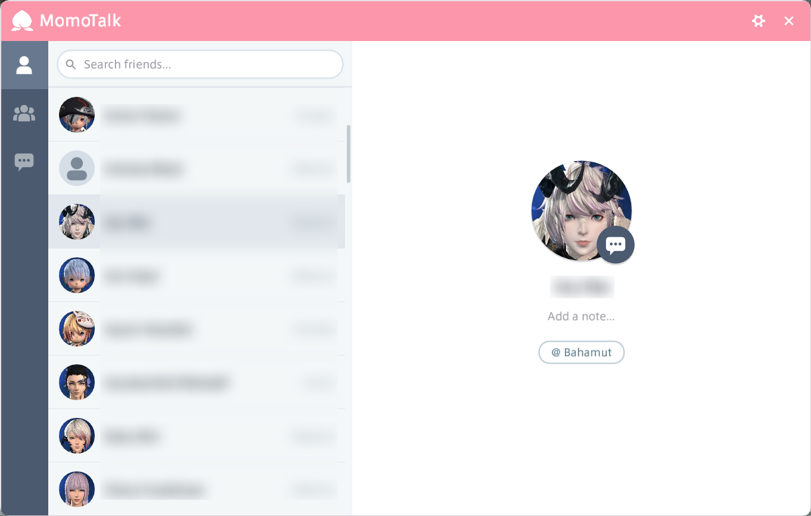
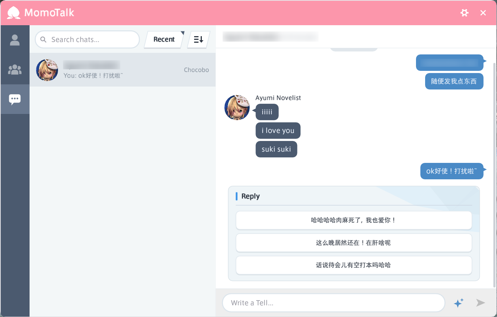

**English** | [简体中文](README.zh.md)



# FFXIV MomoTalk

> [!IMPORTANT]
> Plugin only support **global** client now.

It all came back to me... I'm actually a Sensei who teaches and mentors students in Kivotos, and by some strange twist of fate, I was transported to the continent of Eorzea. Here, those chosen by the god (Hydaelyn) are granted the Blessing of Light to channel the power of aether. Taking on the role of a mysterious figure known as the "Warrior of Light", I travel freely, meeting companions of all personalities and unique abilities, and together we defeat formidable foes and save the fractured world.

Ahem—this is a Dalamud plugin that brings **Blue Archive**'s **MomoTalk** chat interface into **FINAL FANTASY XIV**, letting you send messages to your friends and groups in-game **the adult way**.

## Features



- **Faithful UI Style**: Feels just like being back in Sensei's office.
- **AI Reply Suggestions**: Just as you've always done.
- **Global Floating Launcher**: A draggable MomoTalk entry button.
- **In-Game Messaging**: Supports friend `/tell`, Free Company, Linkshell, and Cross-world Linkshell.
- **Static Group Chat**: Send and receive via Party chat; the current party members must match the saved roster.
- **Persistent Chat History**: Never lose track of any conversation.

## Installation

Add the following custom plugin repository URL in Dalamud Settings (`/xlsettings` → **Experimental** → **Custom Plugin Repositories**):

```text
https://raw.githubusercontent.com/LolipopJ/ffxiv-momotalk/main/pluginmaster.json
```

Then open `/xlplugins`, search for **MomoTalk**, and install it.

## Usage

### Basic Usage

1. Type `/momotalk` in the in-game chat box, or click the floating MomoTalk icon to open the window.
2. Open **Social** → **Friend List** in-game to refresh your friend list.
3. Start Talking!

Similarly, opening the Linkshells window or Free Company window will automatically read and create group chats.

### Creating a Static Group

To save a static roster, right-click a member in the in-game Party List and select **Create Static Group**.

### Enabling AI Reply Suggestions

1. Fill in **Endpoint**, **API Key**, and **Model** under **AI Reply** in the plugin settings.
2. Click the sparkle button in the chat bar to send recent messages and the current conversation notes to the endpoint to generate suggestions. Click a suggestion to send it.

For security reasons, remote endpoints must use HTTPS; HTTP is only allowed for loopback addresses such as `localhost`.

## Requirements & Build

- FINAL FANTASY XIV (global) with **Dalamud API 15**
- **.NET 10 SDK** and Dalamud development assemblies (Windows x64)

```powershell
dotnet restore .\FFXIVMomoTalk.slnx --locked-mode
dotnet build .\FFXIVMomoTalk.slnx -c Release
```

## Credits & Acknowledgements

- Visual design, color palette, layout, and UI interaction references are adapted from **[U1805/momotalk](https://github.com/U1805/momotalk)**.
- **MomoTalk** is inspired by the in-game messenger from **Blue Archive** (Nexon Games / Yostar).
- All image copyrights belong to **Blue Archive** (Nexon Games / Yostar).
