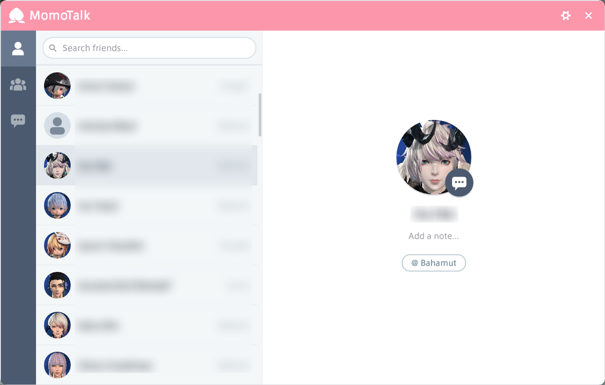
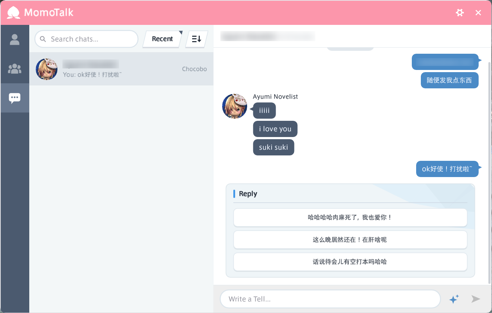

[English](README.md) | **简体中文**



# FFXIV MomoTalk

> [!IMPORTANT]
> 插件目前仅支持**国际服**客户端。

我想起来了……其实我是在基沃托斯教书育人的人民 Sensei，因为一场意外才穿越到了艾欧泽亚大陆。在这里，被神（海德林）选中的人将被授予“光之加护”，导引以太之力。我扮演着一位名为“光之战士”的神秘角色，在自由的旅行中邂逅性格各异、能力独特的同伴们，和他们一起击败强敌，拯救破碎的世界。

咳咳，这是一款 Dalamud 插件，旨在将《蔚蓝档案》的 **MomoTalk** 聊天界面带入《最终幻想 XIV》，让你在游戏内用**大人的方式**与好友和群组发送消息。

## 主要功能



- **还原界面风格**：像回到为师的办公室一样亲切。
- **AI 回复建议**：正如一直以来你做过的那样。
- **全局悬浮入口**：可拖动的 MomoTalk 入口。
- **游戏内聊天**：支持好友私聊、部队、通讯贝和跨服通讯贝。
- **固定队聊天**：通过小队频道收发，当前小队成员须与已保存名单一致。
- **记忆消息历史**：不再丢失任何聊天记录。

## 安装方法

在 Dalamud 设置（`/xlsettings` → **实验性** → **自定义插件库**）中添加以下地址：

```text
https://raw.githubusercontent.com/LolipopJ/ffxiv-momotalk/main/pluginmaster.json
```

打开 `/xlplugins`，搜索并安装 **MomoTalk**。

## 使用方法

### 基本用法

1. 输入 `/momotalk` 或点击悬浮图标打开 MomoTalk。
2. 在游戏内打开 **社交** → **好友名单**，刷新好友列表。
3. 开始 Talk 吧！

相似的，打开通讯贝页面和 FC 页面，将自动读取并创建群组聊天。

### 创建固定队群组

想保存固定队名单，在游戏小队列表中右键点击一位成员，选择 **Create Static Group**。

### 启用 AI 回复建议

1. 在插件设置的 **AI Reply** 中填写 **Endpoint**、**API Key** 和 **Model**。
2. 点击聊天栏的星光按钮，将近期聊天和当前会话备注发送到该接口以生成建议。点击建议即可发送。

为了安全性考量，远程接口需使用 HTTPS，`localhost` 等回环地址可用 HTTP。

## 环境与构建

- 《最终幻想 XIV》国际服与 **Dalamud API 15**
- **.NET 10 SDK** 和 Dalamud 开发程序集，用于构建 Windows x64 版本

```powershell
dotnet restore .\FFXIVMomoTalk.slnx --locked-mode
dotnet build .\FFXIVMomoTalk.slnx -c Release
```

## 致谢与引用说明

- 界面设计、配色、布局和交互参考开源项目 **[U1805/momotalk](https://github.com/U1805/momotalk)**。
- **MomoTalk** 概念源自游戏《**蔚蓝档案（Blue Archive）**》（Nexon Games / Yostar）。
- 一切图片版权归《**蔚蓝档案（Blue Archive）**》（Nexon Games / Yostar）所有。
